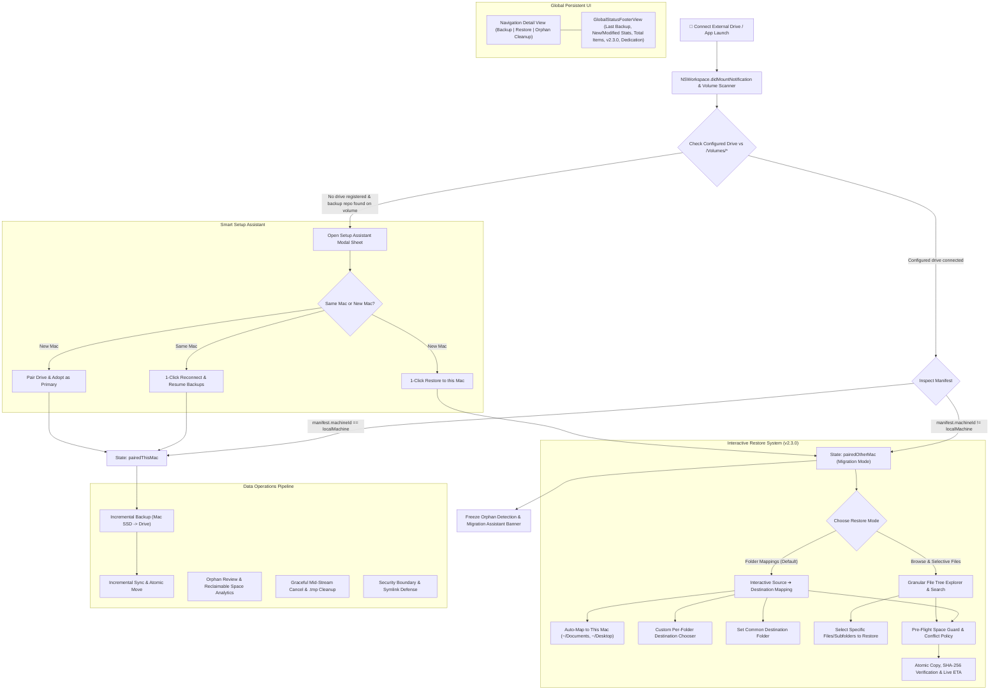

# MacBackup Architecture & Design 🏗️

This document details the internal design, components, and data flow of **MacBackup v2.3.0**.

---

## 1. High-Level Architecture Flow

---

## 2. Core Components

### `BackupManifest.swift`
- **Data Model**: Implements `BackupManifest`, `SourceMapping`, and `MachineMetadata` conforming to `Codable` and `Sendable`. Versioned at `"2.3.0"`.
- **On-Disk Manifest**: Stored in a hidden container directory `.macbackup/manifest.json` on the target volume.
- **Machine Identification**: Compares persistent `machineId` in `UserDefaults` against the manifest's `lastBackupMachine.machineId`.
  - When matching: the current machine is recognized as the owner.
  - When non-matching: automatically engages **Migration Mode**, freezing orphan marking so that files from the previous Mac are protected from accidental deletion.

### `BackupManager.swift`
The central observable engine (`ObservableObject`), handling all backup, restore, metrics, security checks, and lifecycle events:
1. **Interactive Source & Destination Restore Mapping (v2.3.0)**:
   - `FolderRestoreMapping`: Data model representing each backed-up source folder (`folderName`, `sourceFolderURL`, `destinationURL`, `isSelected`, `totalSize`, `fileCount`, `originalPath`).
   - `refreshRestoreFolderMappings()`: Inspects `targetNodes` and manifest sources to dynamically generate folder mappings. Preserves custom user destination choices across view updates.
   - `autoMapRestoreDestinationsToStandardFolders()`: 1-click remapping of all discovered backup folders to standard user directories on this Mac (`~/Documents`, `~/Desktop`, `~/Pictures`, etc.).
   - `setCommonRestoreDestination(_:)`: Directs all selected folders into a user-specified parent directory (e.g. `~/RestoredBackup/Documents`).
   - `performMappedRestore(mappings:conflictPolicy:)`: Restores selected source folders into their respective target destinations, preserving directory structure, with sleep prevention, live ETA, and SHA-256 integrity verification.
2. **Selective File & Subfolder Restore (v2.3.0)**:
   - `restoreCheckedNodes`: Dedicated selection set for restoring specific files or subdirectories from the backup file tree.
   - `performSelectiveRestore(nodes:destinationURL:conflictPolicy:)`: Restores checked items directly into a chosen folder without corrupting parent paths.
3. **Smart Drive Discovery & Interactive Setup Assistant**:
   - `DiscoveredBackup`: Encapsulates discovered backup volume URL, backup folder URL, manifest metadata, volume display name, and machine matching boolean.
   - `scanMountedVolumesForBackups()`: Scans all mounted volumes (`/Volumes/*`) via `FileManager.default.mountedVolumeURLs` for existing `.macbackup/manifest.json` containers without requiring manual folder picking.
   - `reconnectDiscoveredBackup(_:)`, `prepareRestoreFromDiscoveredBackup(_:)`, `adoptAndPairDiscoveredBackup(_:)`.
4. **Path Security & Boundary Containment**:
   - `PathSecurity.relativeSubpath`: Canonical prefix stripping to eliminate path traversal vulnerabilities and duplicate directory collisions.
   - `PathSecurity.isSubpath`: Enforces hard boundary checks on all deletion and recovery operations.
5. **Fail-Safe Incremental Backup**:
   - Re-entrancy guards prevent overlapping executions (`guard !isBackingUp && !isRestoring`).
   - Sleep prevention via scoped `ProcessInfo` activity assertions.
   - Cross-filesystem timestamp tolerance: 2.0-second window plus post-copy timestamp synchronization.
   - Sequence numbering on archive collisions (`_1`, `_2`) to prevent accidental deletion of historical versions.
   - Per-file error isolation: transient file read failures are safely skipped without aborting the broader backup job.
6. **Storage & Reclaimable Space Analytics**:
   - `StorageMetrics` tracks total volume capacity, free space, active backup footprint, version archives, and space consumed by orphaned files.
   - Real-time Mac SSD free space monitoring for pre-flight safety checks.
7. **Live Performance & Graceful Cancellation**:
   - Real-time throughput (`transferRateFormatted` in MB/s) and rolling ETA (`estimatedTimeRemainingFormatted`).
   - `cancelTransfer()`: Instantly halts active transfers and immediately purges orphaned `.tmp` files.
8. **Restore Engine & Space Guard**:
   - `canRestore(bytesNeeded:)`: Validates destination Mac SSD storage with a safety margin before initiating recovery.
   - Atomic replacement: uses `FileManager.replaceItemAt` during overwrite restores to guarantee the original file is preserved if transfer fails.
   - Safe conflict policies: `Keep Both` (with sequence numbering), `Overwrite`, and `Skip If Exists`.

### `ContentView.swift`
- **Interactive Restore View (`RestoreDetailView`)**:
  - **Empty State (`RestoreEmptyStateView`)**: When no drive is connected, displays a helpful guide with a 1-click "Choose Backup Folder..." button and a list of all auto-discovered backups on external volumes.
  - **Source Repository Banner (`RestoreSourceHeaderView`)**: Displays repository path, origin Mac, and last updated timestamp with a quick "Switch Backup..." button.
  - **Restore Mode Switcher**: Toggle between **Folder Mappings** and **Browse & Selective Files**.
  - **Folder Mappings (`FolderMappingRestoreView` & `FolderMappingRowView`)**:
    - Per-folder card showing source folder name, size, file count, and original Mac path.
    - Directional arrow pointing to the mapped destination path on the current Mac.
    - "Change..." button to choose any custom folder, and reset button to return to standard default.
    - Batch actions: "Auto-Map to This Mac", "Set Common Destination...", "Select All", and "Deselect All".
  - **Selective Browser (`SelectiveFileRestoreView`)**:
    - Live file search and filter bar.
    - Hierarchical tree explorer with checkboxes for granular restoration of individual files and subfolders.
    - Dedicated restore destination selector.
  - **Pre-Flight Space & Conflict Policy Bar**:
    - Displays total selected size, available Mac SSD space, and conflict policy selector.
    - Prominent confirmation dialog before starting restore.
- **Global Persistent Status Bar (`GlobalStatusFooterView`)**:
  - Permanently anchored at the base of the application window across all 3 primary tabs (**Backup**, **Restore**, **Orphan Cleanup**).
  - Displays Last Backup timestamp, New Files count, Modified Files count, Total item count, version string (`v2.3.0`), and dedication (*"Made for my Love - DG"*).

---

## 3. Data Safety & Integrity Model

| Failure Mode | Mitigation in MacBackup v2.3.0 |
| :--- | :--- |
| **Inflexible Restore Destination** | Source-to-Destination folder mapping allows mapping each backup folder to custom locations. |
| **Hidden Restore Selection** | Dual-mode restore UI (Folder Mappings + Selective File Tree with search) directly in Restore tab. |
| **New Mac / Reinstalled Mac Setup Confusion** | Automated `/Volumes/*` scanner detects backup containers and prompts with guided Setup Assistant sheet. |
| **Status Bar Hidden on Tab Navigation** | `GlobalStatusFooterView` moved to root `NavigationSplitView detail:`, remaining permanently visible across all tabs. |
| **Infinite Hashing Loop (DoS)** | `hashFile` checks `!data.isEmpty` on `FileHandle.read` EOF. |
| **Path Traversal / Name Collision** | `PathSecurity.relativeSubpath` canonical prefix stripping. |
| **Arbitrary File Deletion** | `PathSecurity.isSubpath` enforces strict boundary inside target folder. |
| **FAT32 Timestamp Jitter Loop** | 2.0-second tolerance window + post-copy timestamp synchronization. |
| **Archive Collision Loss** | Sequence numbering (`_1`, `_2`) prevents deleting past archives. |
| **Restore Overwrite Data Loss** | Atomic replacement via `FileManager.replaceItemAt`. |
| **Symlink Recursion / Leaks** | Symlink detection and directory symlink suppression. |
| **Transient File Abort** | Per-file `do/catch` error isolation prevents backup failure. |
| **Sleep Assertion Leak** | Scoped `activityToken` lifecycle tied to async task `defer`. |
| **Re-entrancy Corruption** | `guard !isBackingUp && !isRestoring` on all entry points. |
| **New Mac False Orphans** | Manifest machine detection automatically engages Migration Mode and freezes orphan status. |

---

## 4. Build & Distribution System

- **Target Architecture**: Apple Silicon (`arm64-apple-macosx`) exclusively.
- **CI/CD Automation**: GitHub Actions workflow ([`.github/workflows/build.yml`](file:///.github/workflows/build.yml)) runs unit tests (`swift test`), compiles release binaries, packages `.dmg`, and publishes releases on version tags.
