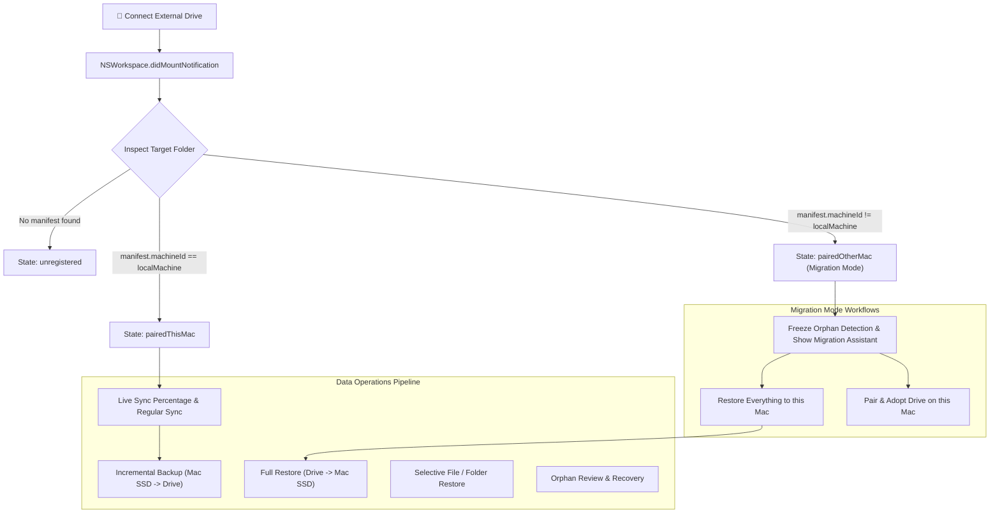

# MacBackup Architecture & Design 🏗️

This document details the internal design, components, and data flow of **MacBackup v1.1.0**.

---

## 1. High-Level Architecture Flow

---

## 2. Core Components

### `BackupManifest.swift`
- **Data Model**: Implements `BackupManifest`, `SourceMapping`, and `MachineMetadata` conforming to `Codable` and `Sendable`.
- **On-Disk Manifest**: Stored in a hidden container directory `.macbackup/manifest.json` on the target volume.
- **Machine Identification**: Compares persistent `machineId` in `UserDefaults` against the manifest's `lastBackupMachine.machineId`.
  - When matching: the current machine is recognized as the owner.
  - When non-matching: automatically engages **Migration Mode**, freezing orphan marking so that files from the previous Mac are protected from accidental deletion.

### `BackupManager.swift`
The central observable engine (`ObservableObject`), handling all backup, restore, and lifecycle events:
1. **Drive Registration & Lifecycle**:
   - Manages four distinct states: `.disconnected`, `.unregistered`, `.pairedThisMac`, and `.pairedOtherMac`.
   - `deregisterFromThisMac()`: Unlinks the drive from the current Mac's local preferences without altering any backup data.
   - `deregisterAndWipeMetadata()`: Removes `.macbackup/` container metadata while preserving user files.
   - `adoptBackupForThisMac()`: Updates the manifest's owning machine to the current Mac, re-enabling regular backup sync.
2. **Fail-Safe Incremental Backup**:
   - Sleep prevention via `ProcessInfo.processInfo.beginActivity([.userInitiated, .idleSystemSleepDisabled])`.
   - Timestamp archiving: Older target files are renamed to `[name]_[YYYYMMDD_HHmmss].[ext]` before modified source files are written.
   - Staged atomic writes (`.tmp` -> SHA-256 verify -> atomic move).
   - Dynamic update of `sources` mappings in the container manifest.
3. **Restore Engine**:
   - Reverse safe staging: copies from external drive to a local `.tmp` file, computes SHA-256 checksums, and atomically moves to destination.
   - Conflict policies:
     - `Keep Both`: appends `(Restored)` or `(Restored N)` to avoid overwriting existing work.
     - `Overwrite`: safely replaces existing files after checksum verification.
     - `Skip If Exists`: preserves local files.
   - Sleep prevention and retry logic during restoration.
4. **Orphan Management & Safety Guards**:
   - Automatically pauses orphan marking when `isMigrationMode` is active or when local `sourceFolders` are empty.
   - **Safety Guard**: If over 50% of files on the backup disk appear to have no local match, orphan deletion is hard-locked to prevent accidental mass deletion.
   - Flat list helpers (`allOrphans`, `allVersionedArchives`) for dedicated review.
   - Reverse recovery action: `recoverOrphan(node:to:)` to restore deleted files directly back to the Mac SSD.

### `ContentView.swift`
- **Top Segmented Views**:
  - **Backup View**: Hierarchical tree explorer, file preview, source folder pickers, and live sync percentage.
  - **Restore View**: Destination picker (defaulting to user's home folder `~`), conflict policy menu, one-click "Restore All to This Mac", and "Restore Checked".
  - **Orphan Cleanup View**: Dedicated filter for orphaned items and versioned archives, individual/batch "Recover to Mac", and protected deletion.
- **Migration Assistant Banner**: Displayed prominently whenever a drive from another Mac is plugged in.
- **Sidebar**: Real-time status badge (green, orange, yellow, red), volume path, eject button, and drive management menu.

---

## 3. Data Safety & Integrity Model

| Failure Mode | Mitigation in MacBackup v1.1.0 |
| :--- | :--- |
| **New Mac False Orphans** | Manifest machine detection automatically engages Migration Mode and freezes orphan status. |
| **Accidental Overwrites** | Prior versions timestamp-archived during backup; `Keep Both` policy available during restore. |
| **Silent Bit Rot / Transfer Glitches** | SHA-256 double-hashing on both backup writes and restore writes. |
| **System Sleep Mid-Transfer** | `ProcessInfo` sleep prevention activity assertion on both backup and restore jobs. |
| **Unintended Orphan Deletion** | Deletion hard-locked when >50% orphans detected or sources unlinked. |

---

## 4. Build & Distribution System

- **Target Architecture**: Apple Silicon (`arm64-apple-macosx`) exclusively.
- **CI/CD Automation**: GitHub Actions workflow ([`.github/workflows/build.yml`](file:///.github/workflows/build.yml)) triggers on release tags (`v*`, numeric) to compile, package `.dmg`, and publish releases.
