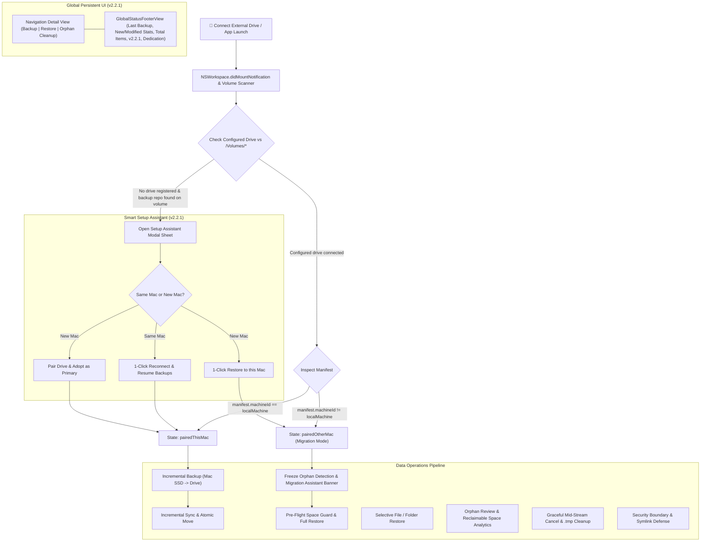

# MacBackup Architecture & Design 🏗️

This document details the internal design, components, and data flow of **MacBackup v2.2.1**.

---

## 1. High-Level Architecture Flow

---

## 2. Core Components

### `BackupManifest.swift`
- **Data Model**: Implements `BackupManifest`, `SourceMapping`, and `MachineMetadata` conforming to `Codable` and `Sendable`. Versioned at `"2.2.1"`.
- **On-Disk Manifest**: Stored in a hidden container directory `.macbackup/manifest.json` on the target volume.
- **Machine Identification**: Compares persistent `machineId` in `UserDefaults` against the manifest's `lastBackupMachine.machineId`.
  - When matching: the current machine is recognized as the owner.
  - When non-matching: automatically engages **Migration Mode**, freezing orphan marking so that files from the previous Mac are protected from accidental deletion.

### `BackupManager.swift`
The central observable engine (`ObservableObject`), handling all backup, restore, metrics, security checks, and lifecycle events:
1. **Smart Drive Discovery & Interactive Setup Assistant (v2.2.1)**:
   - `DiscoveredBackup`: Encapsulates discovered backup volume URL, backup folder URL, manifest metadata, volume display name, and machine matching boolean.
   - `scanMountedVolumesForBackups()`: Scans all mounted volumes (`/Volumes/*`) via `FileManager.default.mountedVolumeURLs` for existing `.macbackup/manifest.json` containers without requiring manual folder picking.
   - `reconnectDiscoveredBackup(_:)`: 1-click reconnection that sets target folder, saves security bookmark, restores source folder paths from manifest, and triggers sync calculation.
   - `prepareRestoreFromDiscoveredBackup(_:)`: Connects target folder in read-only migration mode and immediately switches navigation to the Restore tab.
   - `adoptAndPairDiscoveredBackup(_:)`: Adopts the repository, re-writes the manifest with the current Mac's credentials, and activates regular sync.
2. **Path Security & Boundary Containment**:
   - `PathSecurity.relativeSubpath`: Canonical prefix stripping to eliminate path traversal vulnerabilities and duplicate directory collisions.
   - `PathSecurity.isSubpath`: Enforces hard boundary checks on all deletion (`deleteNode`, `deleteSelectedNodes`) and recovery (`recoverOrphan`) operations to ensure no files outside the backup volume can ever be modified or removed.
3. **Drive Registration & Lifecycle**:
   - Manages four distinct states: `.disconnected`, `.unregistered`, `.pairedThisMac`, and `.pairedOtherMac`.
   - `deregisterFromThisMac()`: Unlinks the drive from the current Mac's local preferences without altering any backup data.
   - `deregisterAndWipeMetadata()`: Removes `.macbackup/` container metadata while preserving user files.
   - `adoptBackupForThisMac()`: Updates the manifest's owning machine to the current Mac, re-enabling regular backup sync.
   - `autoLinkStandardFolders()`: Matches folders recorded in the manifest with corresponding local directories on the current user's Mac (`~/Documents`, `~/Desktop`, `~/Pictures`, etc.).
4. **Fail-Safe Incremental Backup**:
   - Re-entrancy guards prevent overlapping executions (`guard !isBackingUp && !isRestoring`).
   - Sleep prevention via scoped `ProcessInfo` activity assertions.
   - Cross-filesystem timestamp tolerance: 2.0-second window plus post-copy timestamp synchronization to prevent FAT32/exFAT duplicate archive loops.
   - Sequence numbering on archive collisions (`_1`, `_2`) to prevent accidental deletion of historical versions.
   - Per-file error isolation: transient file read failures (e.g. temporary caches) are safely skipped without aborting the broader backup job.
   - Symlink cycle suppression: skips directory symlinks to avoid recursion loops and private credential leaks.
5. **Storage & Reclaimable Space Analytics**:
   - `StorageMetrics` tracks total volume capacity, free space, active backup footprint, version archives, and space consumed by orphaned files.
   - Real-time Mac SSD free space monitoring for pre-flight safety checks.
6. **Live Performance & Graceful Cancellation**:
   - Real-time throughput (`transferRateFormatted` in MB/s) and rolling ETA (`estimatedTimeRemainingFormatted`).
   - `cancelTransfer()`: Instantly halts active transfers and immediately purges orphaned `.tmp` files.
7. **Restore Engine & Space Guard**:
   - `canRestore(bytesNeeded:)`: Validates destination Mac SSD storage with a safety margin before initiating recovery.
   - Atomic replacement: uses `FileManager.replaceItemAt` during overwrite restores to guarantee the original file is preserved if transfer fails.
   - Safe conflict policies: `Keep Both` (with sequence numbering), `Overwrite`, and `Skip If Exists`.
8. **Algorithmic Performance & Caching**:
   - Fast $O(1)$ node lookup dictionary (`nodeLookup`) replacing recursive $O(M \times N)$ traversals during selection actions.
   - Cached `allOrphans` and `allVersionedArchives` arrays to maintain 60/120 FPS SwiftUI list scrolling.
   - Static pre-compiled regular expressions for timestamp matching.

### `ContentView.swift`
- **Global Persistent Status Bar (`GlobalStatusFooterView`)**:
  - Permanently anchored at the base of the application window across all 3 primary tabs (**Backup**, **Restore**, **Orphan Cleanup**).
  - Displays Last Backup timestamp, New Files count, Modified Files count, Total item count, version string (`v2.2.1`), and dedication (*"Made for my Love - DG"*).
- **Interactive Setup Assistant Sheet (`SetupAssistantView`)**:
  - Automatically presented when an unregistered or unconfigured drive containing an existing backup container is detected.
  - Presents clear distinction between "Same Mac" (reconnect & resume) and "New Mac" (restore or adopt).
- **Segmented Views**:
  - **Backup View**: Hierarchical tree explorer, file preview, live throughput (MB/s), ETA, progress bar with instant Cancel, and source folder pickers.
  - **Restore View**: Destination picker, Mac SSD free space indicator, conflict policy menu, one-click "Restore All to This Mac", and "Restore Checked" with pre-restore space verification.
  - **Orphan Cleanup View**: Reclaimable space header badge, dedicated filter for orphaned items and versioned archives, individual/batch "Recover to Mac", and protected deletion.
- **Migration Assistant Banner**: Displayed prominently whenever a drive from another Mac is connected, featuring 1-click **Auto-Link Folders**, **Restore**, and **Pair Drive**.
- **Sidebar**: Real-time status badge, visual storage usage bar (used/free), volume path, eject button, drive management menu, and 1-click "Set Up [Drive]" button when discovered drives are awaiting configuration.

---

## 3. Data Safety & Integrity Model

| Failure Mode | Mitigation in MacBackup v2.2.1 |
| :--- | :--- |
| **New Mac / Reinstalled Mac Setup Confusion** | Automated `/Volumes/*` scanner detects backup containers and prompts with guided Setup Assistant sheet. |
| **Status Bar Hidden on Tab Navigation** | `GlobalStatusFooterView` moved to root `NavigationSplitView detail:`, remaining permanently visible across all tabs. |
| **Confusing "Drive Connected (Unregistered)" Text** | Disambiguated into "No Drive Configured" vs "Unregistered Drive Connected" with clear discovery actions. |
| **Infinite Hashing Loop (DoS)** | `hashFile` checks `!data.isEmpty` on `FileHandle.read` EOF. |
| **Path Traversal / Name Collision** | `PathSecurity.relativeSubpath` canonical prefix stripping. |
| **Arbitrary File Deletion** | `PathSecurity.isSubpath` enforces strict boundary inside target folder. |
| **FAT32 Timestamp Jitter Loop** | 2.0-second tolerance window + post-copy timestamp synchronization. |
| **Archive Collision Loss** | Sequence numbering (`_1`, `_2`) prevents deleting past archives. |
| **Restore Overwrite Data Loss** | Atomic replacement via `FileManager.replaceItemAt`. |
| **Symlink Recursion / Leaks** | Symlink detection and directory symlink suppression. |
| **Transient File Abort** | Per-file `do/catch` error isolation prevents backup failure. |
| **Sleep Assertion Leak** | Scoped `activityToken` lifecycle tied to async task `defer`. |
| **Re-entrancy Corruption** | `guard !isBackingUp && !isRestoring` on all entry points. |
| **New Mac False Orphans** | Manifest machine detection automatically engages Migration Mode and freezes orphan status. |

---

## 4. Build & Distribution System

- **Target Architecture**: Apple Silicon (`arm64-apple-macosx`) exclusively.
- **CI/CD Automation**: GitHub Actions workflow ([`.github/workflows/build.yml`](file:///.github/workflows/build.yml)) runs unit tests (`swift test`), compiles release binaries, packages `.dmg`, and publishes releases on version tags.
